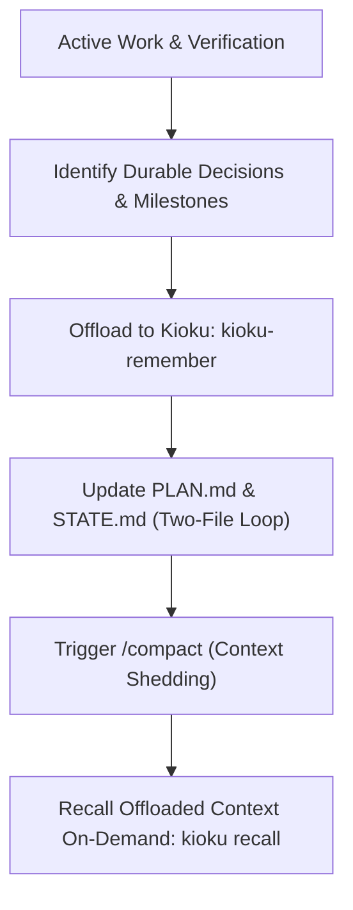

# Shinzui Kioku — Durable Agent Memory & Context Offloading

[`shinzui kioku`](file:///home/nyc/src/kioku/) is an event-sourced, durable agent memory and session distillation system backed by PostgreSQL (`postgresql:///kioku`) using `keiro` (0.22), `kiroku` (0.12), `pgvector`, and `pgmigrate`.

> [!IMPORTANT]
> **Kioku Duality: Two Different Tools**
> 1. **`open-kioku` (`ok`)**: Structural code navigation, AST symbol graphs, definitions, and file references backed by SQLite (`.ok/`).
> 2. **`shinzui kioku` (`kioku`)**: Persistent agent memory, context offloading, session turn distillation, scenes (L2), persona (L3), and full-text/hybrid memory search backed by PostgreSQL (`postgresql:///kioku`).

---

## 1. Context Trimming & Quota Preservation Workflow

In long pair-programming sessions across multi-package Haskell repositories (`polytropos`, `gachi`, `gargamelle`, `tengri`, `gongju`, `sarutahiko`), accumulating conversational turns rapidly drains the agent's token quota because every previous step is included in subsequent prompt payloads.

To keep context windows clean without losing decisions, instructions, or architectural facts:



### Steps at PLAN / STATE Sync Points:

1. **Offload Durable Memories**:
   Record critical architectural decisions, discovered constraints, or resolved bug root causes:
   ```bash
   kioku-remember "Polytropos uses a flat SmallArray payload representation for both sums and products" --tags "architecture,smallarray"
   ```
2. **Update the Two-File Loop**:
   Record operational state in `PLAN.md` and active session frontiers in `STATE.md`.
3. **Trim Context**:
   Use `/compact` (or recommend `/compact` to the user) to prune conversational history from the prompt window.
4. **Recall On Demand**:
   When working on a subsequent task or fresh session, retrieve relevant offloaded facts:
   ```bash
   kioku recall "<query>" --namespace-wide antigravity --strategy keyword
   ```

---

## 2. Scope Conventions

Kioku organizes memories within isolation boundaries (**memory spaces**, default: `kioku_legacy`) and structured **scopes**:

| Scope Level | Format | Example | Purpose |
|---|---|---|---|
| **Repository Scope** | `antigravity:repo:<repoName>` | `antigravity:repo:polytropos` | Project-specific facts, build requirements, toolchain versions |
| **Task Packet Scope** | `antigravity:task:<taskId>` | `antigravity:task:TP-META-004` | Task packet status, implementation decisions, blockers |
| **Global Bucket** | `antigravity` | `antigravity` | Cross-project conventions, agent preferences, system guidelines |

---

## 3. Command Reference

### A. Recording Memories (`kioku-remember`)

The `kioku-remember` CLI automatically detects the active git repository to set the default scope:

```bash
# Record a fact in the current repository scope
kioku-remember "Cabal 3.16.1.0 semaphore protocol alignment configured for GHC 9.14 compatibility"

# Record with explicit type, priority, and tags
kioku-remember "Ensure IO and database tests use unique temporary paths to prevent concurrency collisions" \
  --scope antigravity:repo:polytropos \
  --type constraint \
  --priority 0 \
  --tags "concurrency,tests,io"

# Memory types:
#   fact        - Concrete verifiable project fact or discovery
#   pattern     - Idiomatic architectural pattern or convention
#   preference  - User or agent operational preference
#   constraint  - Strict rule, boundary, or invariants
#   instruction - Actionable procedure or runbook guidance
```

### B. Recalling Memories (`kioku recall`)

```bash
# Search across all scopes in the antigravity namespace
kioku recall "semaphore" --namespace-wide antigravity

# Search within a specific repository scope
kioku recall "SmallArray" --scope antigravity:repo:polytropos

# Hybrid recall (FTS5 BM25 + pgvector RRF score fusion)
kioku recall "flat payload" --namespace-wide antigravity --strategy hybrid --show-scores

# Return up to N matches (1..100)
kioku recall "architecture" --namespace-wide antigravity --limit 5
```

### C. Reading Distilled Scenes & Personas

- **L2 Scenes**: Markdown summaries of all active memory atoms in a scope:
  ```bash
  kioku scenes --scope antigravity:repo:polytropos
  ```
- **L3 Persona**: Distilled stable profile of a scope's preferences, patterns, and durable constraints:
  ```bash
  kioku persona --scope antigravity:repo:polytropos
  ```

---

## 4. Environment & Daemon Configuration

The `kioku` wrapper script (`/home/nyc/.local/bin/kioku`) supplies these default environment variables:

| Variable | Default Value | Description |
|---|---|---|
| `PG_CONNECTION_STRING` | `postgresql:///kioku` | libpq connection string to local PostgreSQL |
| `KIOKU_AI_CONFIG` | `/home/nyc/.config/kioku/ai-config.json` | Baikai version 1 model and transport configuration |
| `KIOKU_MEMORY_SPACE` | `kioku_legacy` | Memory partition boundary |
| `KIOKU_ACTOR` | `antigravity` | Attribution principal for writes |

### Running the Background Worker (for distillation timers):
```bash
kioku worker --timers-once
```
